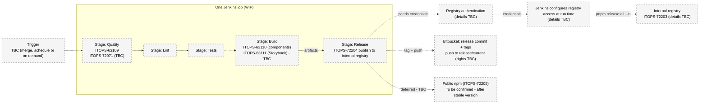

# WIP - target Jenkins pipeline: ONE job, several stages (details TBC)

Draw.io source: [`boreal-jenkins-pipeline-wip.drawio`](boreal-jenkins-pipeline-wip.drawio)

**Status: WIP. No Jenkinsfile exists yet; stage details are TBC. Storybook deploy stays manual.**

