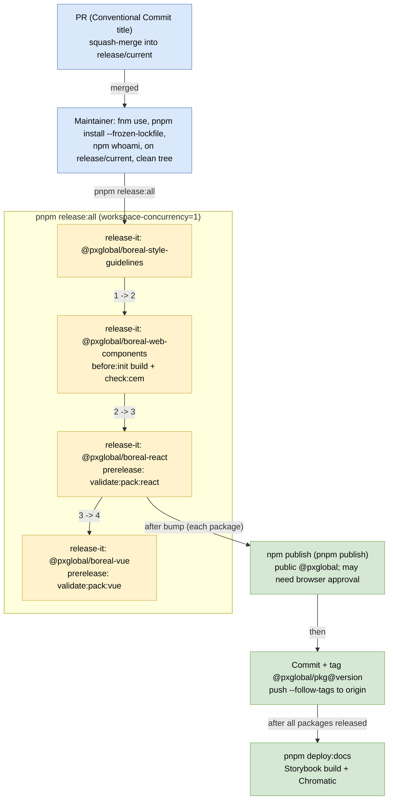

# Current manual release flow (maintainer machine, macOS/Linux)

Draw.io source: [`boreal-release-flow.drawio`](boreal-release-flow.drawio)

The edge from the React node to `PUB` is drawn that way in the draw.io source. In practice every package that has a releasable bump goes through publish, tag and push, as described in `RELEASING.md`.
